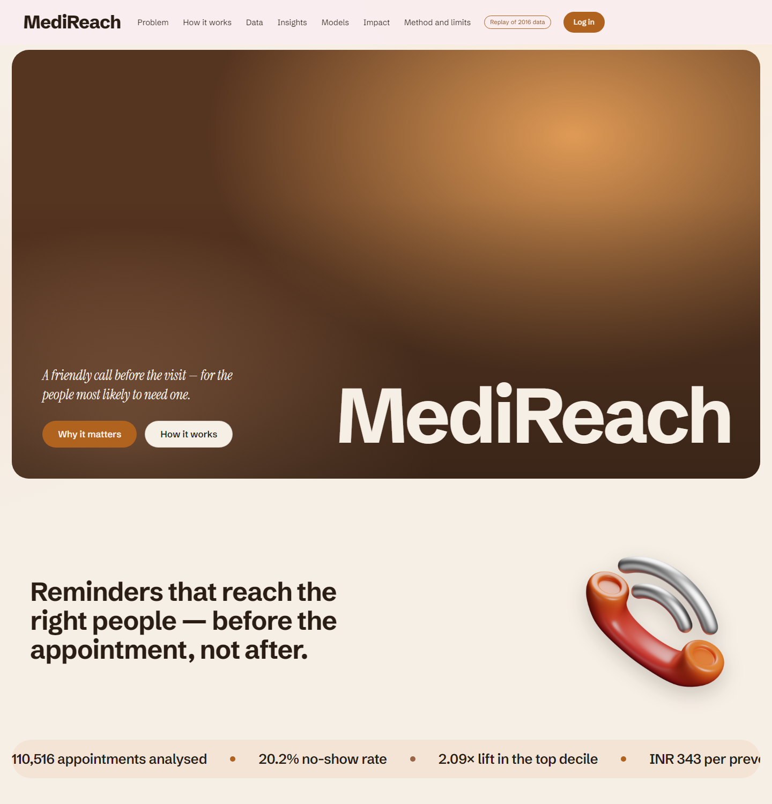
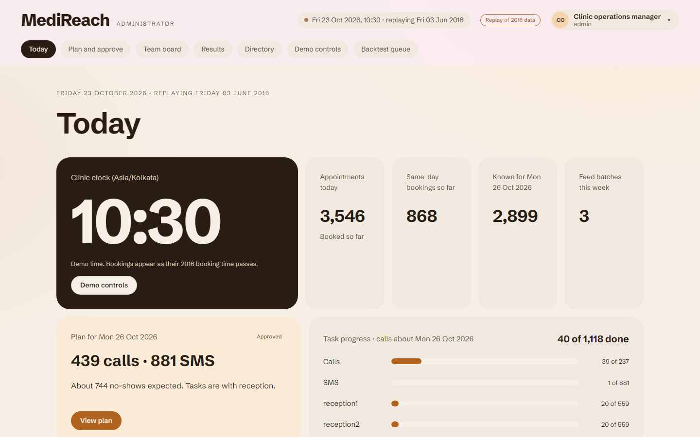
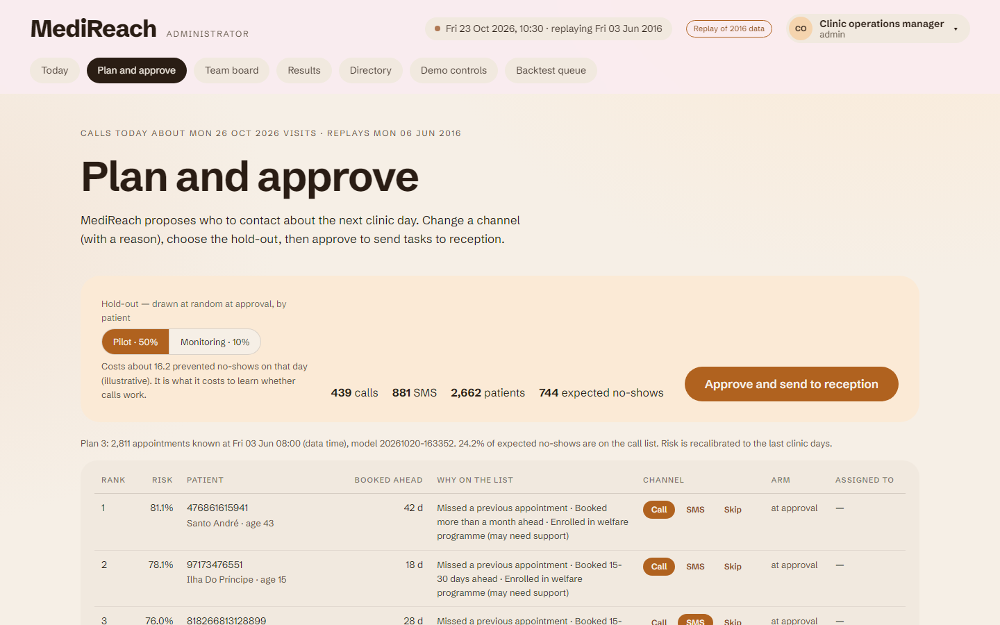
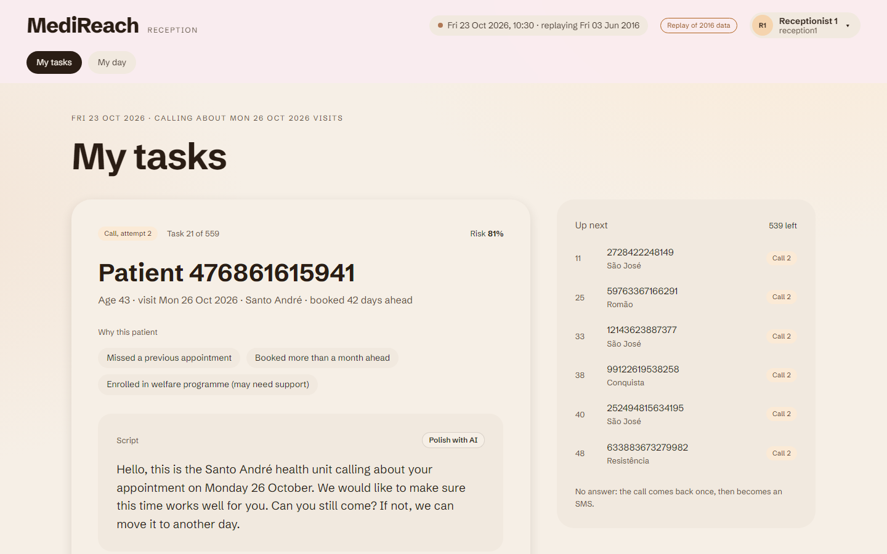
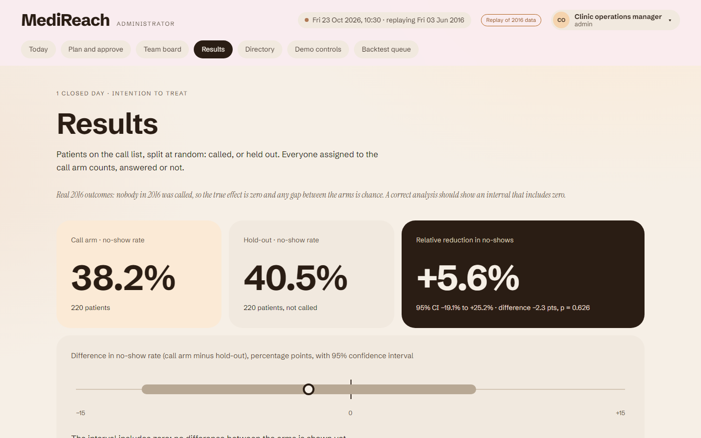

# MediReach

[](https://github.com/antimateguy/MediReach/actions/workflows/tests.yml)

**Who should the clinic contact before their appointment, given a limited number of calls?**

MediReach is a no-show risk and outreach-prioritisation tool for outpatient clinics. It cleans 110,000
appointment records into a SQLite database, tests six hypotheses about what drives no-shows with SQL and
basic statistics, scores each appointment with an explainable model, turns the scores into a daily call
and SMS list under a fixed capacity, and estimates what that list is worth under explicit assumptions.
A web app tells the story and runs the clinic's daily workflow on a replay of the data: the manager
approves tomorrow's list with a randomised hold-out, receptionists work it, and the hold-out measures
whether calls help.

It is a rebuild. Version 1 reported a 0.74 AUC that came from a leaking feature and had silently dropped
35% of the data. How it was found and fixed is in [docs/DATA_NOTES.md](docs/DATA_NOTES.md) and [docs/DESIGN.md](docs/DESIGN.md).

## Results

All figures are from `artifacts/` (written by the pipeline). Test period: 2 to 8 June 2016, 21,985
appointments the models never saw, no-show rate 18.5%.

| Model | ROC-AUC | PR-AUC | No-shows in top 10% | No-shows found in top 30% | Lift, top 10% |
|---|---|---|---|---|---|
| Lead-time baseline (one rule) | 0.690 | 0.274 | 28.2% | 47.8% | 1.53 |
| **Logistic regression (selected)** | **0.728** | **0.335** | **38.6%** | **52.6%** | **2.09** |
| Random forest | 0.729 | 0.332 | 37.8% | 52.9% | 2.04 |

Source: `artifacts/model_comparison.csv`. The forest does not beat logistic regression by more than
0.01 ROC-AUC on validation, so the simpler, explainable model is kept.

What that means for the decision (capacity: call 10% and SMS 20% of each day):

| | No-show rate | Appointments |
|---|---|---|
| Call list (HIGH) | 38.8% | 2,200 |
| SMS list (MEDIUM) | 29.3% | 4,399 |
| No contact (LOW) | 12.5% | 15,386 |

| Strategy, same budget | No-shows prevented (est.) | Net benefit (INR, est.) |
|---|---|---|
| Random outreach | 147 | -19,097 |
| Lead-time baseline | 229 | 21,856 |
| Logistic regression | 270 | 42,376 |
| Oracle (upper bound) | 564 | 189,751 |

Source: `artifacts/impact_comparison.csv`. The benefit figures are **illustrative**: they assume a call
connects 60% of the time and then prevents 30% of no-shows, at INR 40 per call and INR 500 per kept
visit. The programme breaks even if a connected call prevents 13.4% of no-shows.

Honest caveats, also shown in the app:

- Same-day bookings (35% of appointments, 4.6% no-show) are easy to rank last and lift the headline AUC.
  Among appointments booked ahead, ROC-AUC is 0.601 (0.544 for the baseline).
- The data is observational. The model predicts risk, not who responds to a call. The real effect needs
  a randomised pilot; the app sizes one (735 patients per arm, about 4 clinic days).
- Predicted probabilities run high on the test period (the no-show rate fell from 21.1% to 18.5%).
  Ranking, which the queue uses, is unaffected.

## Project status

- **v2: complete.** Engine, analytics, model, daily queue, impact estimate; 188 tests at the time.
- **v3: built.** Clinics as a real table; the live daily replay on today's calendar (booking feed with
  checks, an as-of view so nothing from the future leaks); demo logins and an append-only audit trail;
  the daily workflow (the admin proposes, edits and approves tomorrow's plan with a randomised hold-out;
  receptionists work their tasks; after the day, attendance is revealed and the call arm is compared with
  the hold-out); a feature study; AI briefings and scripts on the free Gemini tier.
- **Web app (Block J): built.** The final design runs as a web app (`web/`) over a small JSON API
  (`medireach/web/`); every number comes from the engine. Frontend, backend and data can be deployed
  separately (Cloudflare Pages + Render). The earlier Streamlit interface was removed.

### Running a replay week in the demo

1. Log in as `admin`. Open **Demo controls** and press "Next clinic day, 08:00".
2. **Plan and approve**: propose the plan, change a patient if you like (with a reason), choose the
   hold-out, approve.
3. Log in as `reception1` (a private window, or "Switch account") and work a few tasks on **My tasks**,
   or, as admin, press "Complete all" on Demo controls to simulate the rest.
4. Back on Demo controls, go to the next clinic day and repeat. Attendance for a day appears after it
   has passed; **Results** shows the call arm against the hold-out. Switch the outcome source to the
   simulation on Demo controls to watch the analysis find a planted effect.

### What the extra information is worth, and whether the measurement works

From `artifacts/feature_ablation.csv` (validation ROC-AUC): lead time alone 0.699; adding patient history,
age and gender, health flags and SMS takes logistic regression to 0.736. With lead time only, all three
models score 0.699, so the gain comes from information, not model complexity.

From `artifacts/replay_validation.json` (one replay week through the whole workflow, 1,100 patients per
arm): with real 2016 outcomes the hold-out shows -5.4% (95% CI -17.3% to +5.3%), correctly no effect;
with a planted 30% effect it shows +19.4% (+9.2% to +28.5%).

## Screenshots

The story page (every number from the pipeline's artifacts):



| The manager's day | Plan and approve, with the randomised hold-out |
|---|---|
|  |  |
| **A receptionist's next task, with the reason and a script** | **Results: call arm against the hold-out, with the 95% interval** |
|  |  |

## Run it on your machine

No Docker needed. You need Python 3.10 or later and git. The repository already contains the built
database, the trained model and the artifacts, so nothing has to be downloaded or trained.

```bash
git clone https://github.com/antimateguy/MediReach.git
cd MediReach
python -m venv .venv
```

Activate the environment (`.venv\Scripts\Activate.ps1` in PowerShell, `source .venv/bin/activate` in
bash), then:

```bash
pip install -r requirements.txt
python -m medireach.web
```

Open http://localhost:8000. Log in with a demo account: `admin` (clinic operations manager) or
`reception1` / `reception2`. The demo password is `MEDIREACH_DEMO_PASSWORD`; while the default from
`.env.example` is in use, the login page shows it. Each browser tab has its own sign-in, so an admin and
a receptionist can work side by side in two tabs. The app creates its workflow database `data/ops.db`
on first start (git-ignored; delete it to start the demo from scratch).

Run the tests (they need two extra packages):

```bash
pip install -r requirements-dev.txt
pytest -q
```

Rebuild everything from the raw data (about two minutes, including the replay validation). First download
`KaggleV2-May-2016.csv` from the dataset page below into `data/raw/`:

```bash
python -m medireach.pipelines.run_all
```

The steps can also be run one at a time: `medireach.pipelines.build_db`, `.insights`, `.train`,
`.score`, `.impact`, `.replay_validation`, `.export_web` (each with `python -m`). Settings are plain
environment variables, all optional; see `.env.example`.

### Or with Docker

Optional, for people who prefer containers or hosts that deploy from a Dockerfile:

```bash
docker build -t medireach .
docker run -p 8000:8000 medireach
```

The image holds only what the app reads (code, SQL, `web/`, the database, model and artifacts); secrets
and local state are excluded by `.dockerignore`. Pass the optional key with `-e GEMINI_API_KEY=...`.

## Architecture: frontend, backend, data

```
FRONTEND  web/  static files          Cloudflare Pages (or served by the backend)
   |  the story: web/data/public.json, no server needed
   |  calculators and clinic portal: JSON over HTTPS, Authorization: Bearer <token>
BACKEND   medireach/web/  Starlette   Render free web service (Docker)
   |
ENGINE    medireach/  (planner, tasks, measurement, model, impact, AI text)
   |
DATA      data/medireach.db (read-only)   data/ops.db (demo workflow state)   models/   artifacts/
```

The same code runs as **one service** (the backend serves the frontend too: local runs, Docker) or
**split** (frontend on Cloudflare Pages, API on Render). Split is what makes the public demo feel fast: free
backends sleep after 15 minutes and take about a minute to wake, but the story page comes from a static
host at once, with every number, and wakes the backend in the background. The data stays inside the
backend on purpose: the analytical database is read-only and fastest in-process. Details and trade-offs:
[docs/DESIGN.md, section 13](docs/DESIGN.md#13-the-web-app-frontend-backend-data).

## Deploying for free

Checked in October 2026 (free tiers change; check before relying on them):

| Host | Used for | Notes |
|---|---|---|
| **Cloudflare Pages** | The frontend (`web/`) | Free, no card; static files on a global CDN, always on |
| **Render** | The backend (API), from the `Dockerfile` via `render.yaml` | Free web service; sleeps after 15 min without visitors and takes a while to wake; 750 free hours a month |

Order (once):

1. **Backend on Render.** New -> Blueprint -> pick this repository. `render.yaml` creates the free web
   service in Singapore, generates `MEDIREACH_SESSION_SECRET`, sets `MEDIREACH_CORS_ORIGINS` and asks for
   `GEMINI_API_KEY` (optional). Wait for the first deploy, then open `https://<service>.onrender.com/api/health`;
   it should answer `{"ok": true}`. That URL alone is also a complete working app.
2. **Frontend on Cloudflare Pages.** Workers & Pages -> Create -> Pages -> connect this GitHub repository.
   Framework preset: None. Build command:

   ```
   printf 'window.MEDIREACH_CONFIG = { apiBase: "%s" };
' "$MEDIREACH_API_URL" > web/config.js
   ```

   Build output directory: `web`. Environment variable `MEDIREACH_API_URL` = the Render URL (no trailing
   slash). The site appears at `https://<project>.pages.dev`.
3. **Connect the two.** If the Pages address is not `https://medireach.pages.dev`, set
   `MEDIREACH_CORS_ORIGINS` in the Render dashboard to your Pages address and redeploy.
4. **Keep the backend awake (optional).** A free uptime pinger (for example cron-job.org) calling
   `https://<service>.onrender.com/api/health` every 10 minutes avoids the cold start; one service running
   all month fits in the 750 free hours.

The demo state (`data/ops.db`: plans, tasks, logins) lives on the backend's disk and resets when Render
restarts or redeploys; the story pages and the analysis are unaffected.

### The Gemini key (optional)

Locally: copy `secrets.toml.example` to `secrets.toml` and paste the key there. That file is
git-ignored. On a host, set `GEMINI_API_KEY` as a secret instead. Get a free key at Google AI Studio
("Get API key"); do not enable billing on the project. Without a key every AI feature uses a template.

## Project layout

```
MediReach/
  README.md            this file
  requirements.txt     pinned runtime dependencies; requirements-dev.txt adds the test tools
  Dockerfile           container image of the backend (.dockerignore keeps secrets and state out)
  render.yaml          free backend deployment on Render
  .github/workflows/   tests.yml (pytest on every push)
  pytest.ini           test settings
  .env.example         optional settings (environment variables)
  secrets.toml.example template for the optional Gemini key
  medireach/           the Python package
    config.py          Settings (paths, seed, bucket edges, capacity shares, impact defaults)
    domain.py          enums and value objects
    errors.py          ConfigError, DataAccessError, ModelBundleError
    artifacts.py       ArtifactStore (reads and writes the result files)
    bootstrap.py       composition root: the only place that picks concrete classes
    data/              cleaning, database, repositories, analytics (views + statistics), hypotheses
    features/          FeatureBuilder: the single feature definition, and the date split
    ml/                models (baseline, logistic, forest), evaluation, model store, feature ablation
    outreach/          policies (threshold, capacity, fixed count), reason codes, OutreachService
    impact/            ImpactSimulator, PilotDesigner
    live/              live replay: ReplayClock, ReplayCalendar, BookingFeed (+ checks), LiveMonitor
    ops/               logins, audit trail, daily plans, tasks, day closing, measurement, demo controls
    assist/            AI text (Gemini free tier): briefing, call scripts, cache, number checks
    web/               the backend: JSON API (server.py), screen payloads, signed login token
    pipelines/         build_db, insights, train, score, impact, replay_validation, export_web, run_all
  web/                 the frontend: index.html, config.js, app.js, styles.css, assets/, data/public.json
  sql/                 schema.sql (analytical tables), views.sql (9 views), ops_schema.sql (workflow tables)
  tests/               pytest suite (leakage tripwire, SQL/pandas parity, contract tests, web API)
  docs/                DESIGN, INSIGHTS, DATA_NOTES
    screenshots/       the README images
  data/
    raw/               the Kaggle CSV (git-ignored; download link below)
    medireach.db       the built analytical database (read-only for the app)
    ops.db             workflow state written by the app (git-ignored, created on first start)
  models/              the saved model bundle and the LATEST pointer
  artifacts/           metrics, tables and scores written by the pipelines
```

## Documentation

- [docs/DESIGN.md](docs/DESIGN.md) - architecture, class and flow diagrams, design decisions
- [docs/INSIGHTS.md](docs/INSIGHTS.md) - the six hypotheses with evidence, verdicts and actions
- [docs/DATA_NOTES.md](docs/DATA_NOTES.md) - cleaning rules, the v1 timestamp bug, data quirks

## Data and licence

Dataset: *Medical Appointment No Shows*, published on Kaggle by Joni Hoppen
(https://www.kaggle.com/datasets/joniarroba/noshowappointments). Appointments in the public health
network of one Brazilian city, April to June 2016.

The dataset is licensed **CC BY-NC-SA 4.0** (attribution, non-commercial, share-alike), as stated in
its Kaggle metadata. The raw CSV is not stored in this repository. The files derived from it
(`data/medireach.db` and the per-appointment scores in `artifacts/test_scores.csv`) are shared under the
same licence, for non-commercial use, with the attribution above.

## What this project does not claim

It does not claim that calls or SMS reduce no-shows by any particular amount, that the results transfer
to another clinic, or that a risk score should decide who gets care. See "Method and limits" in the app
and "Limitations" and "Responsible use" in [docs/DESIGN.md](docs/DESIGN.md).
