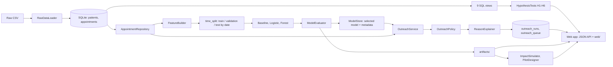
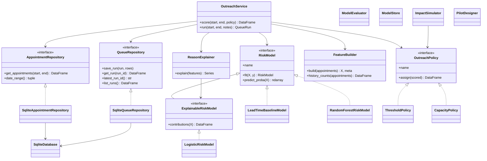
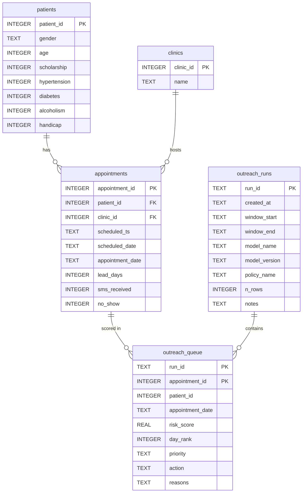
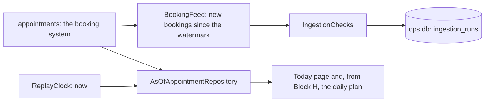

# Design

## 1. Problem

Outpatient clinics lose capacity to no-shows. A call centre can reach a limited number of patients a
day. The decision this system supports: **each day, for the next day's appointments, who gets a phone
call, who gets an SMS, and who gets nothing, under a fixed daily capacity.**

The user is a clinic operations manager. They need a ranked list, a plain-language reason for each
patient on it, and an honest estimate of the benefit.

## 2. The whiteboard version

```
Raw CSV -> [Loader/Cleaner] -> SQLite -> [Repository] -> [FeatureBuilder] -> [RiskModel]
                                 |                                              |
                             SQL views -> Insights                    scores -> [Policy] -> Queue -> App
                                                                          [ImpactSimulator] <- scores + assumptions
```

Five ideas carry the design. Everything else is detail.

| Idea | Class | In one sentence |
|---|---|---|
| Repository | `AppointmentRepository`, `QueueRepository` | Data access behind an interface, so nothing else knows about SQL |
| One feature definition | `FeatureBuilder` | Training and scoring build features with the same code |
| Swappable model | `RiskModel` | Baseline, logistic regression and forest share `fit` / `predict_proba` |
| Swappable business rule | `OutreachPolicy` | Threshold and capacity policies turn scores into actions |
| Glue | `OutreachService` | Fetch, build features, score, apply policy, explain, save |

## 3. Data flow



Pipelines, in order (`python -m medireach.pipelines.run_all` runs all seven):

| Step | Module | Reads | Writes |
|---|---|---|---|
| 1 | `build_db` | raw CSV | `data/medireach.db`, `cleaning_report.json` |
| 2 | `insights` | SQL views | `hypotheses.json` |
| 3 | `train` | appointments | `models/<version>/`, metrics, gains, calibration, segments, test scores, feature ablation |
| 4 | `score` | appointments, saved model | a new run in `outreach_runs` / `outreach_queue` |
| 5 | `impact` | test scores | strategy comparison, sensitivity grid, pilot plan |
| 6 | `replay_validation` | everything above, a throwaway `ops.db` | `replay_validation.json` |
| 7 | `export_web` | artifacts, database | `web/data/public.json` (the public story for the static site) |

The app never writes to the analytical database: it calls objects from `bootstrap.build_container()`
and never contains SQL or scikit-learn code. From v3 it writes workflow state (ingestion log, logins,
audit trail) to the separate `data/ops.db` (section 10).

## 4. Classes



Dependencies point inward: `pipelines` and `app` use `bootstrap`; `bootstrap` is the only module that
names concrete classes; `OutreachService` receives abstractions in its constructor.

## 5. SOLID, with a real class for each claim

| Principle | Where | What it buys |
|---|---|---|
| **S**ingle responsibility | `RawDataLoader` (`medireach/data/cleaning.py`) cleans and knows nothing about databases; `FeatureBuilder` (`medireach/features/builder.py`) only builds features; `ModelEvaluator` (`medireach/ml/evaluation.py`) only measures | Each class has one reason to change and can be tested alone |
| **O**pen/closed | `RiskModel` (`medireach/ml/models.py`) and `OutreachPolicy` (`medireach/outreach/policies.py`) | A new model or policy is a new class; `OutreachService` and the evaluator are untouched |
| **L**iskov substitution | `tests/test_repositories.py` runs one contract test against `SqliteAppointmentRepository` and an in-memory double; `tests/test_policy.py` does the same for both policies | Any implementation can stand in for another without the caller noticing |
| **I**nterface segregation | `ExplainableRiskModel` adds `contributions` only for models that can explain themselves; `AnalyticsQueries` is read-only and separate from the repositories | The forest is not forced to fake an explanation; the app's analytics cannot write |
| **D**ependency inversion | `OutreachService` (`medireach/outreach/service.py`) takes repositories, a model and a policy as abstractions; `bootstrap.build_container()` wires the concrete ones | The service is tested end to end with in-memory doubles and a stub model |

## 6. Schema



The queue has no outcome column on purpose. Backtests join the real outcome from `appointments`, so a
score can never be stored next to its label. Runs are appended and never deleted.

## 7. Key decisions

| Decision | Choice | Why |
|---|---|---|
| Database | SQLite file, standard-library `sqlite3` | Zero setup, reproducible, deployable, and still full SQL with window functions. Repositories hide the engine, so another database is one new class |
| Interface | Static web app over a small Starlette JSON API (v1-v3 used Streamlit) | The final design needed a real web page; the engine did not change |
| Train/test split | By appointment date, 60/20/20 | Production predicts the future. A random split lets the model see the future and inflates metrics |
| History features | Strictly earlier dates only | Scoring happens the evening before; same-day outcomes are not known yet and must not leak |
| Class imbalance (about 20% positive) | No resampling, no class weights; ranking metrics | The system ranks patients. Weighting distorts probabilities without improving the ranking |
| Models | Lead-time baseline, logistic regression, random forest | The baseline is the SQL insight as a model: ML must beat it. Logistic regression is explainable. The forest checks whether non-linearity adds anything |
| Model selection | On validation only; simpler model unless beaten by more than 0.01 ROC-AUC; test looked at once | Avoids fitting to the test set; a defensible simplicity rule |
| Scaling | Inside the model, continuous columns only | Binary coefficients stay readable as log odds ratios; the scaler cannot be mismatched with the model |
| Outreach rule | Capacity policy (top share of each day); threshold kept as the naive alternative | A call centre has fixed headcount. On the test week a 0.50 cut-off gave 91 to 122 calls a day; capacity gave a planned 10% |
| Explanations | Logistic contributions (coefficient x value), added up per concept, top three positive | Exact for logistic regression, no extra library, and robust to the overlapping history columns |
| Impact | Backtest on the test period with explicit assumptions, break-even and sensitivity | Defensible without pretending to know the causal effect of a call |
| Currency | Illustrative amounts in INR | The dataset is Brazilian; the amounts are a scenario, not a measurement |

## 8. Limitations

- **Observational data.** The model predicts who is likely to miss, not who would respond to outreach.
- **No uplift estimate.** Benefit depends on assumed effectiveness; a randomised pilot is the next step.
- **Six-week window.** History exists for 29.9% of training rows and 58.4% of test rows, so the history
  features see a different mix in training than in use. A longer history would help most.
- **One city, 2016.** Not validated anywhere else.
- **Calibration drift.** The no-show rate fell from 21.1% (training) to 18.5% (test); probabilities run
  high. The queue uses rank, so the list is unaffected, but the raw percentages should be read as scores.
- **Same-day bookings flatter the headline.** ROC-AUC is 0.728 overall and 0.601 among appointments
  booked ahead.
- **Collinear history columns.** Individual history coefficients are not interpretable one by one;
  `artifacts/history_block.csv` reports their combined effect.
- **Clinic location is not a model feature.** The `Neighbourhood` column is where the appointment takes
  place (not where the patient lives). It differs reliably for only 10 of 74 sites; it is analysed in
  the insights and left out of the score. It is stored as a `clinics` table referenced by each
  appointment. Block I1 of v3 tests a leakage-safe encoding of it as a feature.

## 9. Responsible use

Welfare-programme enrolment and handicap are used only to prioritise supportive outreach. The score must
never restrict access, deprioritise care or justify overbooking against particular patients. Performance
is reported by gender and age group (`artifacts/segment_metrics.csv`): ROC-AUC is 0.728 for women and
0.726 for men, and ranges from 0.669 (age 65+) to 0.732 (age 18-34) across age groups.

## 10. v3 additions so far (Block G)

**Two databases.** `data/medireach.db` is the analytical warehouse: built by the pipelines, committed,
read-only for the app. `data/ops.db` holds what the running app writes (ingestion log, users, audit
trail; plans and tasks from Block H). It is created on first start from `sql/ops_schema.sql`, every
statement of which is idempotent, and it is never committed.

**Live replay.** The test week (Thursday 2016-06-02 to Wednesday 2016-06-08) is replayed on the real
calendar, weekday by weekday.

| Class | File | Job |
|---|---|---|
| `ReplayClock` | `medireach/live/clock.py` | Real date and time -> replayed data date and time; a new replay week every Thursday |
| `ReplayCalendar` | `medireach/live/clock.py` | Clinic days, next clinic day, and the data time at which a plan is made (08:00 on the previous clinic day) |
| `AsOfAppointmentRepository` | `medireach/data/repositories.py` | Decorator over any appointment repository: hides bookings not yet made and outcomes not yet known |
| `BookingFeed`, `IngestionChecks` | `medireach/live/feed.py` | Incremental, idempotent intake with a watermark per replay week; quality checks per batch |
| `SqliteIngestionLog` | `medireach/live/feed.py` | The batch log in `ops.db` |
| `LiveMonitor` | `medireach/live/status.py` | Runs the feed and summarises what is known now (Today page) |



**Logins and audit trail.** `PasswordHasher` (salted PBKDF2-SHA256, standard library), `AuthService`
(seeds the demo accounts once, logs every login attempt without the password), `require_role`.
`SqliteUserRepository` and `SqliteEventLog` in `medireach/ops/repositories.py`. The `events` table is
append-only, enforced by database triggers.

**Navigation.** The web app shows each role only its own screens, and every API route checks the role
itself (section 13). (Until Block J this was a Streamlit router; it was removed.)

## 11. v3 workflow (Block H)

```mermaid
sequenceDiagram
    participant E as Engine (DailyPlanner)
    participant A as Admin
    participant R as Receptionist (TaskService)
    participant C as DayCloser
    participant M as ExperimentAnalyzer
    A->>E: Propose the plan for the next clinic day (from 08:00 the day before)
    E->>A: Scores as of plan time, one decision per patient, capacity from staffing
    A->>E: Overrides (each with a reason), late bookings, choose hold-out
    A->>E: Approve: randomise hold-out, create tasks, deal them out
    R->>R: Calls and SMS; outcomes logged; one retry, then SMS
    C->>C: After the plan day: open tasks expire
    C->>M: After the target day: attendance revealed (real or simulated), plan closed
    M->>A: Call arm vs hold-out, reach, released slots, pilot progress
```

| Class | File | Job |
|---|---|---|
| `DailyPlanner`, `HoldoutAllocator` | `medireach/ops/plans.py` | Propose, edit, approve; seeded hold-out; round-robin assignment |
| `TaskService` | `medireach/ops/tasks.py` | Task state machine, retries, SMS fallback, reassignment, batch recording |
| `OutcomeSource`, `HistoricalOutcomes`, `PlantedEffectOutcomes`, `DayCloser` | `medireach/ops/outcomes.py` | What happened after a day; closing the day on the clock |
| `ExperimentAnalyzer`, `Recalibrator` | `medireach/ops/measurement.py` | Intention-to-treat comparison, honest planning numbers |
| `DemoControls`, `OperationsCycle` | `medireach/ops/demo.py` | Demo clock, outcome source, auto-complete, reset; one refresh per page load |
| `SqlitePlanRepository`, `SqliteTaskRepository`, `StateStore` | `medireach/ops/workflow_store.py` | Plans, items, outcomes, tasks, demo settings in ops.db |
| `FixedCountPolicy` | `medireach/outreach/policies.py` | Top-K calls and SMS per day (a new policy; nothing else changed) |
| `TemplateScripts` | `medireach/assist/scripts.py` | Call script and SMS from the reasons (AI drafts come in Block I) |

The outcome source is a strategy (`OutcomeSource`): the analysis code is the same whether attendance is
the real 2016 outcome or a simulation with a planted effect. With real outcomes the true effect is zero
by construction; with a planted effect the analysis should find it. Both are tested.

## 12. v3 Block I additions

| Class / module | File | Job |
|---|---|---|
| `FeatureAblation`, `ClinicEncoder` | `medireach/ml/ablation.py` | What each feature group adds (validation only); leakage-safe clinic encoding |
| `TextGenerator`, `GeminiGenerator`, `TextCache`, `read_api_key` | `medireach/assist/llm.py` | One interface for AI text; Gemini free tier over HTTPS; cache; number check helpers |
| `BriefingWriter`, `briefing_facts` | `medireach/assist/briefing.py` | Admin briefing: template always, AI on request, checked |
| `ScriptWriter`, `TemplateScripts` | `medireach/assist/scripts.py` | Call script and SMS; AI polish on request, checked |
| `replay_validation` | `medireach/pipelines/replay_validation.py` | The whole workflow over a fixed week, real and simulated outcomes |

The AI is a `TextGenerator` chosen in `bootstrap` (Gemini when a key exists, otherwise none and the
templates are used). Pages never call it directly; the writers do, and they fall back to the template on
any failure.

Pipelines, in order (`run_all`): build_db, insights, train (now with the ablation), score, impact,
replay_validation, export_web.

## 13. The web app: frontend, backend, data

The interface is a static single-page app over a small JSON API. It replaced the earlier Streamlit app
(removed) without changing the engine: the API calls the same container the pipelines use.

```
FRONTEND  web/  (static files: index.html, config.js, app.js, styles.css, assets/, data/public.json)
   |  public story: data/public.json, no server needed
   |  calculators and portal: fetch CONFIG.apiBase + /api/...   (JSON; Authorization: Bearer <token>)
   v
BACKEND   medireach/web/server.py   WebApp: routes, role check, one workflow lock, error -> HTTP status
   |  calls
   v
          medireach/web/payloads.py  one function per screen: engine -> plain JSON (no HTTP)
   |
   v
ENGINE    bootstrap.Container        planner, task service, analyzer, demo controls, writers, artifacts
   |
   v
DATA      data/medireach.db (analytical, read-only)   data/ops.db (workflow state)   models/   artifacts/
```

| Class / module | File | Job |
|---|---|---|
| `WebApp`, `create_app` | `medireach/web/server.py` | Starlette routes; runs the operations cycle (feed catch-up, day closing) before each workflow request; gzip; cache headers; CORS for a separate frontend; warm-up at start |
| payload functions | `medireach/web/payloads.py` | What each screen shows; numbers stay numbers, dates come with a label |
| `SessionSigner` | `medireach/web/sessions.py` | HMAC-signed, expiring username token; role and active flag re-read from the user table every request |
| `export_web` | `medireach/pipelines/export_web.py` | Writes `web/data/public.json` with the same payload functions, so the static story and the API cannot disagree (a test checks it) |
| frontend | `web/` | Layout and tokens from the design mock-up; hash router; every number from the engine |

**Two deployments, same code.**

| | One service | Split |
|---|---|---|
| Used for | Local runs, Docker, any single host | The public demo: Cloudflare Pages + Render |
| Frontend served by | The backend itself | Cloudflare Pages (static, always on, CDN) |
| `web/config.js` `apiBase` | empty (same address) | the API's address, written by the Cloudflare Pages build command |
| Backend setting | none | `MEDIREACH_CORS_ORIGINS` = the Pages address |

Why split: a free backend sleeps after 15 minutes and takes about a minute to wake. With the frontend on
a static host, the story (with every number) appears at once even while the backend sleeps; the page
pings `/api/health` on load, so the backend is usually awake by the time someone opens the portal.
Pages that need the backend say "waking up" instead of failing, and retry.

Why the data stays inside the backend: `medireach.db` is read-only and read in-process, which is faster
than any hosted database over the network; `ops.db` holds only demo state that may reset. A hosted
database (free Postgres tiers exist) would let the demo state survive restarts, at the cost of a second
service, a slower read path and a port of the SQL. Not worth it for a demo; the repository classes make
it a contained change if a real clinic ever needed it.

**Login.** `POST /api/login` returns a signed token; the browser keeps it in `sessionStorage` (one tab,
one person: an admin and a receptionist can work side by side in two tabs) and sends it as
`Authorization: Bearer`. No cookie, so it works across sites (Cloudflare Pages and Render are different
sites, and browsers block third-party cookies) and there is no CSRF exposure. CORS allows only the
configured frontend address.

Rules the frontend keeps: no number is computed in the browser except formatting; the replay, Simulated
and Written by AI labels come from the server; the hold-out is chosen as a mode (Pilot 50% / Monitoring
10%), never by hand; every value from the server is HTML-escaped before display.
Run with `python -m medireach.web` (port 8000).
